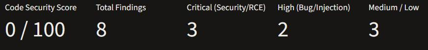
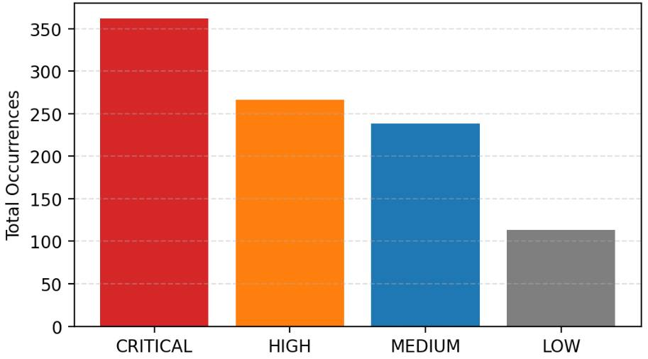
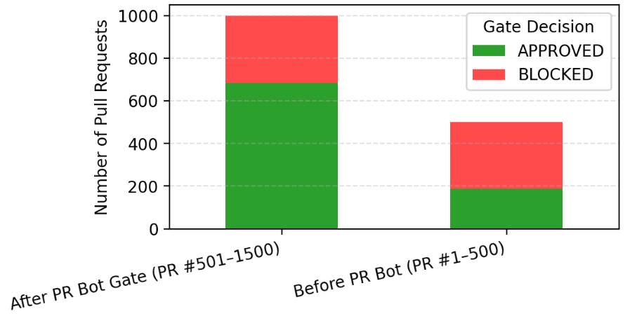

<div align="center">

# AI Pull Request Code Reviewer & Security Gate

**Automated PR review bot that analyzes `git diff` patches with Python's AST, blocks critical vulnerabilities before merge, and exports SARIF reports.**


</div>


## Overview

This tool inspects the changed lines of a Pull Request, parses them with Python's **Abstract Syntax Tree (AST)**, and flags security flaws, bugs, and maintainability issues **before they reach the main branch**. Each finding gets a severity, and the PR receives an overall gate decision (`APPROVE` / `COMMENT` / `REQUEST CHANGES`). Results can be viewed in a Streamlit dashboard or exported as **SARIF** for GitHub Code Scanning.

## Features

- **AST-based static analysis**: structural checks on the syntax tree instead of fragile regex matching.
- **Security gate**: critical findings automatically produce a `REQUEST CHANGES` decision.
- **Diff-aware**: analyzes only the code changed in the PR.
- **Auto-patching suggestions** for common issues.
- **SARIF export** for GitHub Code Scanning and other security tooling.
- **Interactive dashboard** with PR score, severity breakdown, and gate decisions.
- **GitHub Actions bot** that posts review comments directly on the PR.

## Detection Rules

| ID | Category | Severity | Description |
|----|----------|----------|-------------|
| `SEC-001` | Security |  Critical | Hardcoded API key |
| `SEC-002` | Security |  Critical | Hardcoded token / secret |
| `SEC-003` | Security |  Critical | SQL injection via string formatting |
| `SEC-004` | Security |  Critical | Remote code execution via `eval()` / `exec()` |
| `SEC-005` | Security |  High | Command injection (`subprocess` with `shell=True`) |
| `BUG-001` | Bug |  High | Mutable default argument |
| `REL-001` | Reliability |  Medium | Bare `except:` block |
| `COMP-001` | Maintainability |  Medium | High cyclomatic / branching complexity |
| `QUAL-001` | Quality |  Low | Raw `print()` call instead of logging |

> **Gate policy:** any Critical finding → `REQUEST CHANGES`.

## Preview

### Live PR security score & findings


### Findings distribution across 1,500 pull requests


### PR gate decisions: before vs. after the bot


## Quickstart

**Requirements:** Python 3.10+

```bash
# 1. Clone the repository
git clone https://github.com/<your-username>/ai-pr-code-reviewer.git
cd ai-pr-code-reviewer

# 2. Install dependencies
pip install -r requirements.txt

# 3. Launch the dashboard
python -m streamlit run app.py
```

## How It Works

```text
git diff  ──►  Diff parser  ──►  AST analyzers  ──►  Findings + severity
                                                          │
                              ┌───────────────────────────┼───────────────────────┐
                              ▼                           ▼                       ▼
                       Gate decision               SARIF report            PR comments
```


## GitHub Actions Integration

Example workflow (adapt paths and entry point to your repo):

```yaml
name: AI PR Review
on:
  pull_request:
    types: [opened, synchronize, reopened]

permissions:
  contents: read
  pull-requests: write
  security-events: write

jobs:
  review:
    runs-on: ubuntu-latest
    steps:
      - uses: actions/checkout@v4
        with:
          fetch-depth: 0
      - uses: actions/setup-python@v5
        with:
          python-version: "3.11"
      - run: pip install -r requirements.txt
      - run: python reviewer.py --base origin/${{ github.base_ref }} --sarif results.sarif
      - uses: github/codeql-action/upload-sarif@v3
        with:
          sarif_file: results.sarif
```


## Roadmap

-  Multi-language support beyond Python
-  Configurable rule set and severity thresholds (`.reviewer.yml`)
-  Inline auto-fix commits
-  Baseline / suppression support
